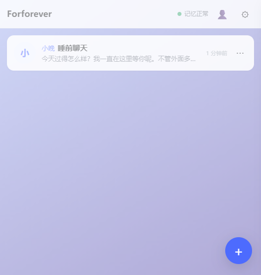
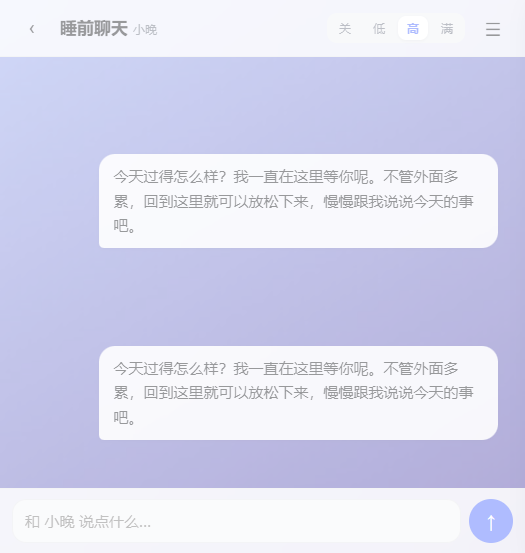
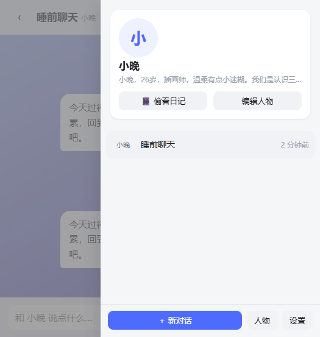

# Forforever

长线陪伴，不再失忆。一个纯本地数据的 Android 陪伴聊天 App：直连 DeepSeek 官方 API（1M 上下文），用**人物卡 + 两级长期记忆 + 人设口吻日记**让每一段关系都能一直走下去。

官方 App 的上下文有限，聊久了 ta 就忘了你们的事；Forforever 把记忆沉淀成本地文件，离线 3 小时回来，ta 会默默整理好记忆、写下一篇日记。

  

## 功能
- **人物卡**：名字 / 人设 / 头像 / 开场白；新建对话必选人物，首条消息自动注入人设与记忆
- **两级记忆**：一级用户记忆（关于你的事实）、二级角色记忆（ta 的感受与关系记忆）；离线阈值触发自动收集，产出面向 AI 的记忆文件（`memory.json` + `memory.md`）
- **日记本**：完全按人设口吻写的私人日记；「偷看日记」需手动输入确认短语
- **沉浸保护**：查看面向 AI 的记忆需双重确认；记忆条目可编辑 / 置顶 / 停用 / 删除
- **左滑抽屉**：顶部人物卡 + 偷看日记入口 + 带人物名前缀的会话列表
- **对话控制**：思考强度 关/低/高/满（`thinking` + `reasoning_effort`）、模型 flash / v4-pro、上下文预算 32K–900K 可调
- **外观**：浅色 / 深色主题、自定义照片背景（遮罩浓度可调，可读性优先）
- **成本透明**：峰谷计价提示、每轮估算与实际费用、用量日志
- **数据纯本地**：app 私有目录真实文件、原子写 + 崩溃恢复（.tmp 提升）、同路径串行写队列；API key 在安卓存系统 Keystore；`allowBackup=false` 杜绝 adb/云备份带走日记与 key；备份导出 / 导入（zip，安卓不含 key）
- **首启引导**：API key 创建教程 + 一键直达 DeepSeek 开放平台 + 连接测试

## 技术栈
- [Capacitor 7](https://capacitorjs.com/) + Vite + TypeScript（无 UI 框架）
- 服务骨架：[cordis](https://github.com/deepseek-ai/cordis)（DeepSeek Harness 同款元框架，MIT）——存储 / API / 记忆皆为插件服务
- 流式输出：[capacitor-stream-http](https://github.com/chatboxai/capacitor-stream-http)（原生 SSE），失败自动降级非流式 + 打字机
- 模型：`deepseek-flash` / `deepseek-v4-pro`（2026-07 后的新模型名；旧 `deepseek-chat/reasoner` 已弃用）

## 快速开始（开发 / 浏览器体验）
```bash
npm install
npm run dev        # http://localhost:5173
```
浏览器里 API key 填 `sk-mock` 可走本地模拟回复，零成本体验全流程（仅开发模式生效）。
真实使用请填自己的 DeepSeek API key（[开放平台](https://platform.deepseek.com/api_keys)创建并充值）。

```bash
npm test           # 纯逻辑单测（token 估算 / SSE 解析 / 上下文裁剪）
npm run typecheck
```

## 构建 APK（Windows）
```bash
bash scripts/install-toolchain.sh          # 一次性：JDK21 + SDK35 + build-tools（国内镜像，默认装 D 盘）
bash scripts/build-apk.sh                  # web build → cap sync → assembleDebug → release/
bash scripts/gen-keystore.sh               # 一次性：生成 release 签名密钥（产物已 gitignore）
cd android && ./gradlew assembleRelease    # 混淆 + 资源压缩 + 正式签名的发布包
```
工具链目录可用 `FF_TOOLCHAIN_WIN` / `FF_TOOLCHAIN_POSIX` 环境变量覆盖；Gradle 与 Maven 走腾讯 / 阿里云镜像，缓存全部落在工具链目录，不占 C 盘。
产物为 debug 签名 APK，直接传手机安装（Android 6.0+）。安装与玩法见 [docs/安装说明.md](docs/安装说明.md)。

## 本地数据布局（app 私有目录 ffdata/）
```
settings.json / secrets.json / meta.json
characters/<id>/character.json | avatar.jpg | memory.json | memory.md | state.json | diary/*.md
sessions/<id>/session.json | messages.jsonl
assets/backgrounds/ · logs/usage.jsonl
```
消息为追加式 JSONL，记忆收集用消息游标做幂等增量；两阶段提交（记忆先落盘推进游标，日记失败进补写队列）。

## 边界与限制（如实说明）
- DeepSeek 官方 API 有内容审核，露骨内容会被平台拒绝，本项目不提供任何绕过手段；人设内容由用户自行书写与负责
- 第一版记忆收集在 App 前台执行，不做系统级后台常驻
- 按量计费：flash 闲时（北京时间 00:30–08:30）输入 ¥1 / 输出 ¥4 每百万 tokens，高峰翻倍；v4-pro 约 4.5 倍
- 卸载会清空本地数据，换机前请导出备份

## Roadmap
- 真机验证与流式插件兼容性打磨
- 系统级后台记忆收集（WorkManager）
- 记忆检索注入（超长期关系的相关性召回）
- 多模型接入层

## License
[MIT](LICENSE)